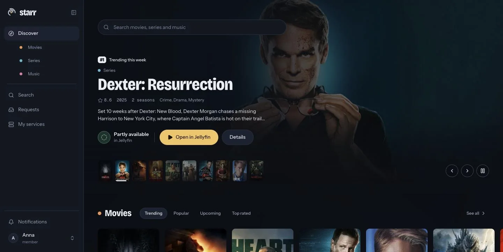
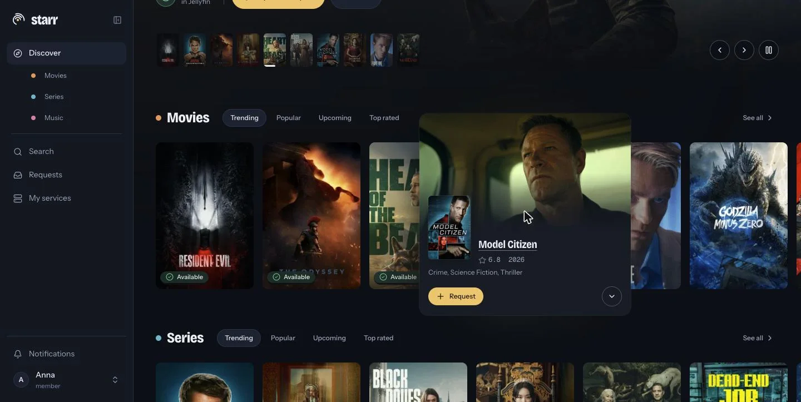
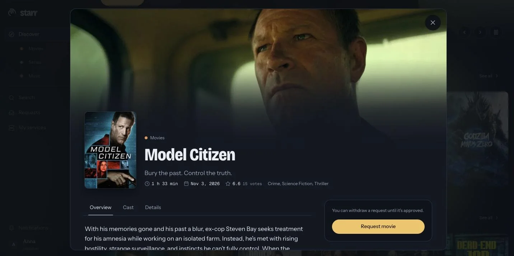
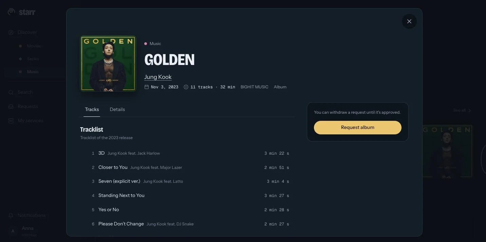
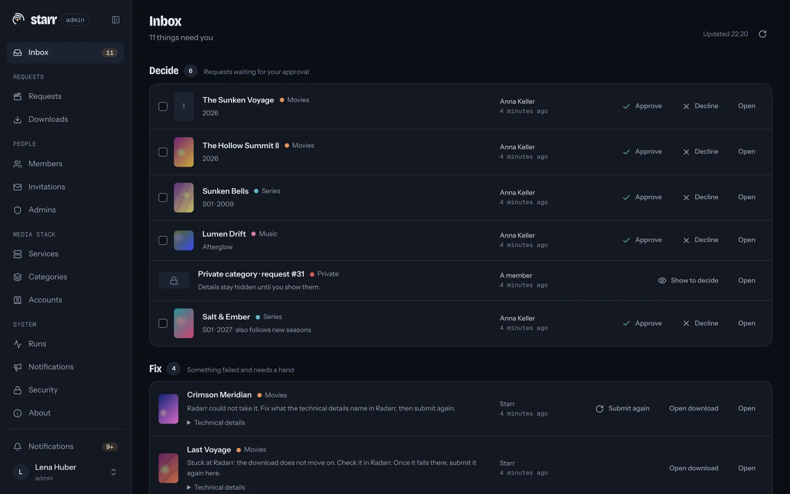
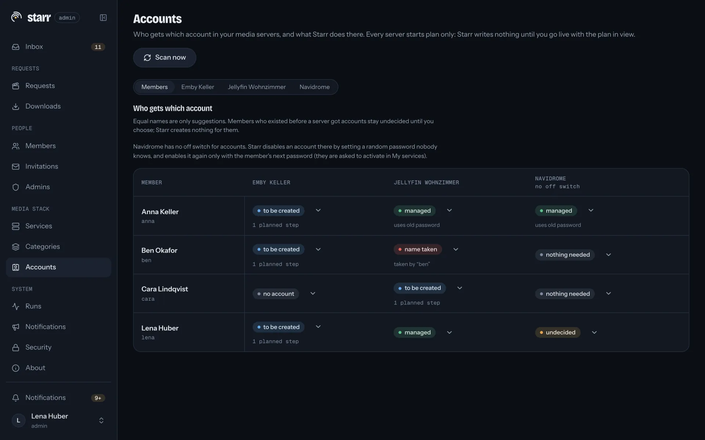

<p align="center">
  <picture>
    <source media="(prefers-color-scheme: dark)" srcset="docs/images/starr-mark.svg">
    <source media="(prefers-color-scheme: light)" srcset="docs/images/starr-mark-on-light.svg">
    
  </picture>
</p>

<h1 align="center">Starr</h1>

<p align="center">
  <strong>One front door for your media stack.</strong><br>
  Your people request movies, series and music in one place.
  You manage who gets in, on every server, from the same screen.
</p>

<p align="center">
  <a href="https://github.com/bitoxo/starr/releases"></a>
  <a href="LICENSE"></a>
  <a href="https://github.com/bitoxo/starr/pkgs/container/starr"></a>
  
</p>

> [!NOTE]
> Starr 0.4.2 is young and pre-1.0 (GPL-3.0-or-later): one maintainer, first commit in November 2026, running against my own production stack. 1.0 comes once it has run stably in real installs for a while.



<details>
<summary>More screenshots</summary>

**Preview card.** Hover a cover for the essentials and the next step.



**Detail overlay.** Everything about a title, and a request button that says what happens next.



**Albums.** From MusicBrainz, with the tracklist, sent to Lidarr.



**Admin inbox.** Approvals and anything that failed, in one list.



**Accounts.** Who has which account on which server, and what Starr would do, before anything is written.



</details>

<sub>Member screenshots come from a real install, admin screenshots from a demo environment with fake services and placeholder data. Posters and artwork via TMDB and Cover Art Archive.</sub>

## What it does

**For your members**

- Request movies and series (TMDB, to Radarr and Sonarr) and albums (MusicBrainz, to Lidarr).
- Follow a series or an artist; new seasons and albums get requested in their name.
- Watch each request go from approval to "ready to watch", then open it in Jellyfin, Emby or Navidrome.

**For you**

- One invite creates a member's accounts on Jellyfin, Emby and Navidrome, with one password and the right libraries. Suspend or remove them in one place.
- Plan-only until you go live: Starr shows what it would change on each server and writes nothing before you say so.
- API keys encrypted at rest, optional web/worker split so the internet-facing part can't read them, TOTP, audit log, no telemetry.
- One Rust binary with SQLite and the UI built in. Rolling back one release is changing the image tag. A fresh install idles at about 20 MB of RAM; the image is about 175 MB.

Starr sits on top of your stack: it doesn't download, index or stream, never deletes media files, and has no AI features. Switch it off and everything keeps working as before. Optional and off by default: a private category for Whisparr and StashDB that only members you allow can see.

## Quick start

```yaml
services:
  starr:
    image: ghcr.io/bitoxo/starr:latest
    container_name: starr
    user: "1000:1000"          # owner of ./config on the host
    environment:
      - STARR_PUBLIC_URL=http://192.168.1.10:7979   # the address you open
    volumes:
      - ./config:/config       # a local disk, not a network share
    ports:
      - "7979:7979"
    restart: unless-stopped
```

1. `mkdir config && chown 1000:1000 config`, and set `STARR_PUBLIC_URL` to the address you will open. Starr rejects changes sent from any other origin; list further addresses (say, a hostname next to the IP) in `STARR_ADDITIONAL_ORIGINS`.
2. `docker compose up -d`, then copy the one-time `SETUP TOKEN` from `docker logs starr`.
3. Open that address and create the first admin. The admin inbox walks you through the rest: connect services (you need a free TMDB API read access token), switch on a category, turn on TOTP, invite members.

Images: `ghcr.io/bitoxo/starr:0.4.2`, `:0.4` or `:latest`. Every environment variable is in [configuration](docs/configuration.md).

## Running it

<details>
<summary><a id="hardened-setup"></a><b>Hardened setup: web and worker as two containers</b></summary>

Run the same image twice: `starr web` serves HTTP and only queues jobs, `starr worker` runs them and opens no port. They share `/config` and talk only through the database. Only the worker holds `secret.key`, which opens the stored service credentials; the web container seals new ones with the worker's public key and can never read them back. The web container holds `web.key` (admins' TOTP secrets, TMDB and StashDB read tokens); the worker gets it read-only.

The complete file is [`compose.split.example.yaml`](compose.split.example.yaml). To switch from a single container: stop it, move `config/secret.key` to `worker-key/` and `config/web.key` to `web-key/`, start both.

- Only one worker runs jobs at a time. A second one waits and takes over within about 15 seconds when the first stops, or a minute if it crashed.
- Both may start together; migrations and the pre-migration backup run once.
- Trade-off: a compromised web container gets the database, TOTP seeds and catalog tokens, but not the key to your services. The cost is a second container and a second key directory to back up.

Internet-facing with member accounts on your media servers? Use this setup: members type their password into the web container, which seals it for the worker.

</details>

<details>
<summary><a id="reverse-proxy"></a><b>Reverse proxy</b></summary>

Point the proxy at port 7979 and set `STARR_PUBLIC_URL` to the public https URL. Set `STARR_BEHIND_PROXY=true` only if Starr is reachable exclusively through the proxy: Starr then trusts one hop of `X-Forwarded-For` (login throttling) and `X-Forwarded-Proto` (`__Host-` `Secure` cookies on https), and only from a loopback or private peer address. From any other peer the headers are ignored.

Publish 7979 only to the proxy:

```yaml
    environment:
      - STARR_PUBLIC_URL=https://starr.example.com
      - STARR_BEHIND_PROXY=true
    ports:
      - "127.0.0.1:7979:7979"   # proxy on the host; drop `ports:` if it shares the Docker network
```

A proxy in the same Docker network needs no published port (point it at `starr:7979`). Docker's published ports bypass host firewalls such as ufw, so binding to an address beats a firewall rule. Rootless Docker and Docker's userland proxy can make every client look private; then only keeping 7979 closed protects you.

**TLS proxy in front and 7979 also open on the LAN** works, but costs something either way: with `false` cookies lack `Secure` and everyone behind the proxy shares one login-throttling address; with `true` anyone on the LAN can pick their own throttling address. Better: close 7979 to all but the proxy, set `true`, and send LAN users through the proxy too.

The image's health check runs inside the container and needs no published port. For outside monitoring use `https://starr.example.com/api/v1/health` (200, or 503 when the database doesn't answer).

Using the private category? Keep its paths out of your proxy's access log ([how](docs/configuration.md#reverse-proxy-and-the-private-category)).

</details>

<details>
<summary><a id="volume-ownership"></a><b>Volume ownership</b></summary>

Starr runs as UID 1000 and needs to own `/config`. Create the directory before the first start, or Docker creates it as root and Starr can't write.

- **Plain Docker:** `chown 1000:1000 config`.
- **Unprivileged LXC** (Proxmox, default mapping), bind-mounted from the host: the host directory belongs to `101000`.
- **Rootless Docker or user namespaces:** the start of your range in `/etc/subuid` plus 999.

`/config` must be on a local disk: SQLite needs working file locks.

</details>

<details>
<summary><a id="backups"></a><b>Backups and restore</b></summary>

Back up all of `/config`, above all **`starr.db` together with `secret.key` and `web.key`**. In the hardened setup the key files live in their own directories; back those up too. Restore `starr.db` without its `secret.key` and Starr asks for every service's API key again; without `web.key` it asks for the catalog tokens and refuses to start while admins have TOTP (restore the key, or `starr admin recover <user> --reset-totp`).

SQLite runs in WAL mode, so copying `starr.db` alone while Starr runs can give you a stale or broken copy. Consistent ways:

- a filesystem snapshot (ZFS, LVM, Btrfs, Proxmox) that takes `starr.db`, `-wal` and `-shm` at the same instant,
- stop the container, copy, start,
- SQLite's online backup, on the host or in another container (the image has no `sqlite3`), as the UID that owns `/config` (as root it can leave root-owned `-wal`/`-shm` files behind that lock Starr out):
  `sudo -u '#1000' sqlite3 config/starr.db ".backup 'backup/starr-$(date +%F).db'"`

To restore a `.backup` file: stop Starr, put it in place as `starr.db` owned by 1000 (or its mapped UID), delete any leftover `starr.db-wal` and `starr.db-shm`. The empty `starr.db.migrate.lock` holds no data; skip it.

</details>

<details>
<summary><a id="updates"></a><b>Updates and rollback</b></summary>

Pull and restart; migrations run at start-up. Before migrating, Starr copies the database to `/config/backups` (newest five kept, database only, no key files).

A release `vX.Y.Z` publishes `X.Y.Z`, `X.Y` and `latest`; a pre-release like `v0.5.0-rc.1` publishes only `0.5.0-rc.1`. Pin `:0.4.2` or `:0.4` to update by hand. The [changelog](CHANGELOG.md) lists what changed.

A release only adds to the schema; removals wait at least one release. CI starts the previous release on the new schema and checks it serves login, so rolling back one release is switching the tag back. Further back: restore from `/config/backups`.

</details>

<details>
<summary><a id="build-from-source"></a><b>Build from source</b></summary>

```sh
git clone https://github.com/bitoxo/starr.git && cd starr
git checkout v0.4.2               # a release tag; leave out to build main
docker build -t starr:0.4.2 .
```

Then use `image: starr:0.4.2`. Expect a few minutes and several GB of build cache (`docker builder prune`). A build from `main` reports the last release's version, so name the commit in bug reports.

</details>

## Good to know

<details>
<summary><a id="supported-services"></a><b>Supported services and versions</b></summary>

| Service | Role | Versions |
|---|---|---|
| Radarr | movie requests | 5.x and 6.x |
| Sonarr | series requests | 4.0.4 and later 4.x |
| Lidarr | album requests | 3.x |
| Whisparr | private category requests | v3, from 3.1.0.2088 |
| Jellyfin | availability, "Open in", accounts | 10.11 and later, below 12.5 |
| Emby | availability, "Open in", accounts | 4.10.x |
| Navidrome | availability, "Open in", accounts | 0.58 to 0.64 |
| TMDB, MusicBrainz, StashDB | catalogs | |
| Email, Discord, webhooks | notifications | |

Outside these ranges Starr keeps reading but stops writing to that service, and says so under Services. Several Jellyfin and Emby instances work side by side.

</details>

<details>
<summary><a id="coming-from-seerr"></a><b>Coming from Seerr</b></summary>

Seerr (formerly Overseerr and Jellyseerr) is mature and does things Starr doesn't. You can run both side by side while you try Starr.

| | Seerr | Starr |
|---|---|---|
| Movies and series | yes | yes |
| Music (Lidarr, MusicBrainz) | no | yes |
| Private category (Whisparr v3) | no | opt-in |
| Media servers | Plex, Jellyfin or Emby, one at a time | Jellyfin and Emby (several each), Navidrome |
| Plex | yes | not planned ([why](#roadmap)) |
| Creates and manages media server accounts | no, imports existing users | yes |
| Follow a series or artist | no | yes |
| Several Radarr/Sonarr servers | yes: a default plus e.g. a 4K server, chosen per request | connect several; one per category takes requests, switchable, no choice per request |
| Request quotas | yes | no, on the roadmap |
| OIDC / SSO login | no | no ([why](#faq)) |
| Languages | many | English, more next |
| Database | SQLite or PostgreSQL | SQLite |
| Licence, maturity | MIT, years, many contributors | GPL-3.0, new, one maintainer |

Seerr column from its README and docs as of November 2026; corrections welcome.

Switching: connect the Radarr and Sonarr you already use (Starr recognises what's there and never removes anything), connect Jellyfin or Emby and map libraries to categories, link existing accounts in plan-only mode, invite members, go live per server. Seerr's request history isn't imported; open requests need to be requested again. Members who want one password switch their existing account to it themselves under "My services".

</details>

<details>
<summary><a id="faq"></a><b>FAQ</b></summary>

**Is it safe against my production servers?** That's what it's built for. Account writes stay off per server until you go live, which needs a fresh login and TOTP for every active admin. Starr never touches administrator accounts, accounts you mark ignored, or accounts a server locked. More than five disables, library removals or deletions per server within an hour wait for your approval. While any active admin has no TOTP (a new admin, too), account writes pause on every live server. Removing a member disables their accounts at once; after 30 days (`STARR_MEMBER_DELETE_GRACE_DAYS`) accounts Starr created are deleted, linked ones released. Give Starr its own credential in each server (an API key; on Navidrome its own admin user) and keep your own admin account as the way in without it.

**Why no OIDC or SSO login?** Most of your people don't watch in a browser. Infuse, Swiftfin, the Emby apps and Subsonic clients log in to each server directly, and OIDC doesn't reach them. So every member gets one password, the same on every server.

**What if I stop using Starr?** Nothing breaks. Accounts, passwords and library access stay as they are, Radarr and Sonarr keep what they have. Remove Starr's API keys and you're done.

**Does it phone home?** No telemetry, no update check, no analytics. Starr talks to your services and the catalogs you use; browsers only talk to Starr. Full host list in [SECURITY.md](SECURITY.md#what-starr-connects-to).

**AI?** No AI features today, and nothing goes to AI services. Anything AI later will be opt-in, off by default, and work with a model you host yourself.

**Locked out?** `docker exec -it starr starr admin recover <username>` (split setup: `starr-web`) prints a set-password link valid for 7 days; the old password works until it's used. `--reset-totp` also turns TOTP off and ends all sessions; `--create` with a new name makes a fresh admin (removed admins stay removed). Every recovery lands in the audit log.

**An album I have looks requestable.** Music availability matches by MusicBrainz ID. Untagged albums aren't recognised; Lidarr with "Write Audio Tags" tags them.

**API?** The OpenAPI description is at `/api/openapi.json`.

**Related to golift's `starr` Go library?** No. Same word, different projects.

</details>

<details>
<summary><a id="roadmap"></a><b>Roadmap</b>: more languages next, then what you vote for</summary>

Next: **more UI languages**.

Then, in the order you vote for them: request quotas · podcasts and audiobooks (Audiobookshelf) · more personal settings · "Open in" your own app (Infuse, Arpeggi, …) · quick trailers · kids accounts · a richer listening profile · your own logo and colours · announcements to members · a nerd corner with uptimes and read-only SQL · a second music metadata source · an iOS app · opt-in AI: requests from listening history, a monthly "new for you" letter.

No dates. Each idea is an issue with the `roadmap` label: [vote with 👍](https://github.com/bitoxo/starr/issues?q=is%3Aissue+is%3Aopen+label%3Aroadmap+sort%3Areactions-%2B1-desc), I sort by votes.

Plex is not planned. Creating and managing each member's accounts is core to Starr. Plex accounts belong to plex.tv, where Starr can't create them or set their password, only share libraries with accounts that already exist.

</details>

<details>
<summary><a id="how-its-built"></a><b>How it's built</b></summary>

One maintainer, with Claude Code writing the code. Every feature starts as a written spec, every structural choice as an architecture decision record, and work lands in small slices with tests first. Each slice is reviewed by a separate review agent and by me, and passes the same checks as CI (run locally with `just ci`) before it merges, including a check that the previous release still runs on the new schema.

That catches a lot, not everything. No independent security review has happened yet; more eyes on the security-relevant parts are the most useful contribution.

</details>

## Contributing

Starr has one maintainer, which is a risk for you and a limit for the project. Wanted: a **co-maintainer**, **adapter owners** who run Emby or Navidrome, **testers** for release candidates, **security reviewers**, later **translators**. Say hello in [Discussions](https://github.com/bitoxo/starr/discussions).

Ideas go to a [feature request](https://github.com/bitoxo/starr/issues/new?template=feature_request.yml); bugs, questions, security and how code gets in: [CONTRIBUTING.md](CONTRIBUTING.md).

References for contributors: verified facts about the services Starr talks to in [docs/concept/capabilities.md](docs/concept/capabilities.md), the visual design system in [docs/design/](docs/design/README.md).

<details>
<summary><b>Development setup</b></summary>

Rust (via rustup), Node 24 with pnpm, [just](https://github.com/casey/just) and sqlx-cli.

```sh
just web-install
just dev      # server on :7979, UI with hot reload on :5173
just check    # what CI checks
```

`just gen-api` regenerates the TypeScript API types after an API change, `just migration <name>` adds a migration (committed ones never change). Crates: `starr-core` (domain, no IO), `starr-db` (SQLite, migrations), `starr-worker` (jobs), `starr-server` (binary, API, embedded UI), `starr-secrets`, `starr-adapter-kit` and one crate per service in `crates/adapters/`. The UI in `web/` is React, TypeScript, Vite and Tailwind.

</details>

## License

[GPL-3.0-or-later](LICENSE), like Sonarr and Radarr. Not affiliated with the Servarr team, Seerr, or golift's `starr` library. This product uses the TMDB API but is not endorsed or certified by TMDB. If Starr is useful to you, you can [buy me a coffee](https://buymeacoffee.com/bitoxo).
